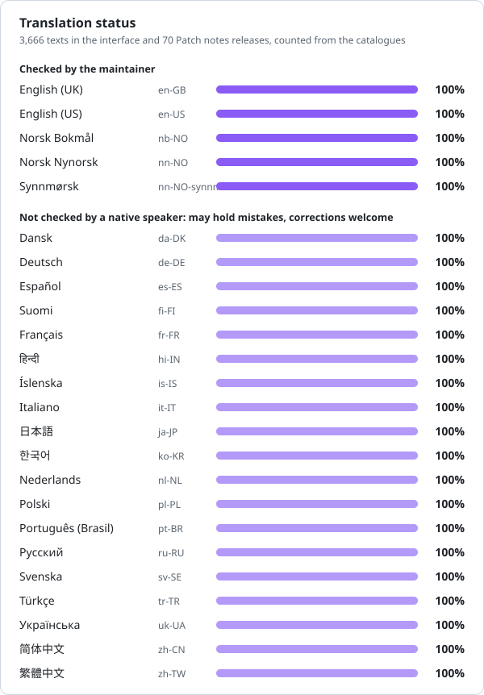

<p align="center"></p>
<h1 align="center">FinStats</h1>

<p align="center">
  <b>See what your Jellyfin server is really doing.</b><br>
  Who is watching, what they watch, how it streams, and your year in review.<br>
  One tiny container. No database server. Set up in two minutes.
</p>

<p align="center">
  <a href="https://demo.finstats.no/"><b>Try the demo</b></a>: FinStats in your browser, with invented people and titles. Nothing to install.<br>
  <a href="https://docs.finstats.no/"><b>Read the docs</b></a>: getting started, settings, importing, security and the HTTP API.
</p>

<p align="center">
  <a href="https://github.com/finstats/finstats/releases/latest"></a>
  <a href="https://github.com/finstats/finstats/pkgs/container/finstats"></a>
  <a href="https://github.com/finstats/finstats/actions/workflows/docker.yml"></a>
  <a href="LICENSE"></a>
</p>

<p align="center">
  
</p>

> **How FinStats is built: with AI assistance.** Most of the code here was written by Claude Code,
> working from the maintainer's design decisions and reviewed before it landed. Nothing is generated
> and forgotten: every change is written test-first, `cargo test` runs in CI on every push to `main`
> and on every release tag, and each release is run against a real Jellyfin server before it ships.
> Said plainly because you should know what you are running; the responsibility for this code is the
> maintainer's, not a model's.

## Why FinStats

Jellyfin tells you what is playing right now. It does not tell you that one client transcodes
everything it touches, that four people stream at once every Saturday, or that a third of your
disk is films nobody has ever pressed play on.

FinStats watches your server quietly in the background and turns that into answers. It is a
lightweight alternative to Jellystat and Streamystats: a single small program with its own
built-in database, using **under 100 MB of memory**, where each of those needs around half a gigabyte.
Nothing else to install, nothing to maintain.

Already using Jellystat or Streamystats, or coming from Plex with Tautulli? [Bring your history with you](https://docs.finstats.no/finstats/imports/). It takes seconds.

## What you get

- **A live view of your server**: every stream as it happens, who, what, where, and whether it transcodes and why.
- **Simple mode**, coming from Plex: a second layout with a bar across the top and the stats alone, laid out the way a classic Plex stats server is.
- **Answers, not just charts**: how busy it gets, which apps transcode, where people give up on a title, which files
  are broken, what your library is made of and what nobody has ever watched.
- **Library health**: missing episodes, odd resolutions, copies, thin files and dubs that stop, each with its numbers.
- **Security**: every play and sign-in on a map drawn on your own machine, with impossible-travel alerts.
- **Pipeline**: Sonarr, Radarr and Seerr, read-only: what was requested, whether it was watched, and what is coming in.
- **Every play down to the pause button**, who watches together, where you are in every show, and a watchlist of your own.
- **Your year in review**, as story cards to share, and a public profile if you want one.
- **Private by design**: sign in with Jellyfin, nothing leaves your network, and FinStats never writes to your server.

[Everything it does, with screenshots →](https://docs.finstats.no/finstats/features/)

## Languages

FinStats speaks 23 languages: every page, the Patch notes and what the server says. Each browser picks its own under
Settings → Appearance → Language, or follows the browser.

> **A note on the translations.** English and Norwegian (Bokmål and Nynorsk) are written and checked by the maintainer,
> who speaks them. The other languages were translated by Claude Opus 5.5 (high effort), an AI model, and the maintainer
> cannot read them, so nobody here has checked whether they are good or bad: they may hold mistakes. If you speak one of
> them and something reads wrong, an issue or a pull request is very welcome. A text a language does not have yet is
> shown in English.

<!-- languages: tools/make-languages.py writes this; run it again when a language changes -->
<p align="center"></p>
<!-- /languages -->

## Get started

You need Docker and a Jellyfin server (10.9 or newer).

```sh
docker run -d --name finstats --restart unless-stopped \
  -p 8080:8080 \
  -e TZ=Europe/London \
  -v "$PWD/data:/data" \
  ghcr.io/finstats/finstats:latest
```

Open **http://your-server:8080**, enter your Jellyfin address and sign in with a Jellyfin administrator account.
[Get started](https://docs.finstats.no/finstats/install/) has Compose, image tags and what happens next.

## Documentation

Everything lives at **[docs.finstats.no](https://docs.finstats.no/)**:

- [Get started](https://docs.finstats.no/finstats/install/), [settings and environment variables](https://docs.finstats.no/finstats/settings/),
  [updating and moving](https://docs.finstats.no/finstats/updating/), [questions](https://docs.finstats.no/finstats/faq/)
- [Bringing your history](https://docs.finstats.no/finstats/imports/) from Jellystat, Streamystats or Tautulli
- [Privacy](https://docs.finstats.no/finstats/privacy/) and the [security model](https://docs.finstats.no/finstats/security/)
- [HTTP API](https://docs.finstats.no/finstats/api/): the contract the web UI is built on
- [Contributing](https://docs.finstats.no/finstats/contributing/), and the [patch notes](CHANGELOG.md)

Found a bug or have an idea? [Open an issue](https://github.com/finstats/finstats/issues/new/choose); found a security
problem? [Report it privately](SECURITY.md). Questions go to
[Discussions](https://github.com/finstats/finstats/discussions). Everyone taking part follows the
[code of conduct](CODE_OF_CONDUCT.md).

## License

FinStats is free software under the [GNU General Public License v3.0](LICENSE). You may use,
study, share and change it; if you distribute a modified version, it has to stay under the same
license with its source available. It comes with no warranty.

The bundled fonts (Inter and JetBrains Mono, and those a FinUI preset may choose in Settings → Appearance) are under
the SIL Open Font License 1.1; each one's licence sits beside it in [`web/assets/fonts`](web/assets/fonts) and is listed on
the in-app Licences page.

<sub>Screenshots show generated demo data: invented users, titles and artwork.</sub>
