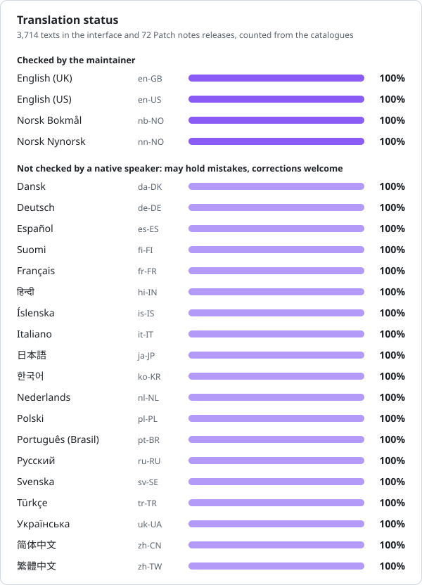

<p align="center"></p>
<h1 align="center">FinStats</h1>

<p align="center">
  <b>See what your Jellyfin server is really doing.</b><br>
  Who is watching, what they watch, how it streams, and your year in review.<br>
  One tiny container. No database server. Set up in two minutes.
</p>

<p align="center">
  <a href="https://demo.finstats.no/"><b>Try the demo</b></a>: FinStats in your browser, with invented people and titles. Nothing to install.<br>
  <a href="https://finstats.no/"><b>Read the docs</b></a>: getting started, settings, importing, security and the HTTP API.
</p>

<p align="center">
  <a href="https://github.com/finstats/finstats/releases/latest"></a>
  <a href="https://github.com/finstats/finstats/pkgs/container/finstats"></a>
  <a href="https://github.com/finstats/finstats/actions/workflows/docker.yml"></a>
  <a href="LICENSE"></a>
</p>

<p align="center">
  
</p>

> **How FinStats is built: with AI assistance.** Most of the code here was written by Claude Code,
> working from the maintainer's design decisions and reviewed before it landed. Nothing is generated
> and forgotten: every change is written test-first, `cargo test` runs in CI on every push to `main`
> and on every release tag, and each release is run against a real Jellyfin server before it ships.
> Said plainly because you should know what you are running; the responsibility for this code is the
> maintainer's, not a model's.

## Why FinStats

Jellyfin tells you what is playing right now. It does not tell you that one client transcodes
everything it touches, that four people stream at once every Saturday, or that a third of your
disk is films nobody has ever pressed play on.

FinStats watches your server quietly in the background and turns that into answers. It is a
lightweight alternative to Jellystat and Streamystats: a single small program with its own
built-in database. Nothing else to install, nothing to maintain.

Already using Jellystat or Streamystats, or coming from Plex with Tautulli? [Bring your history with you](https://finstats.no/finstats/imports/). It takes seconds.

## Resource use

<!-- resource-benchmark: tools/make-benchmark-chart.py writes this from sanitized benchmark JSON -->
<p>Idle UTC endpoints: 2026-10-31T09:49:32Z to 2026-10-31T09:54:31Z; playback: 2026-10-31T09:55:57Z to 2026-10-31T10:00:57Z. FinStats tested revision <code>dc05cbea0da893ba0d2c3b6c6740630721462d99</code>.</p>
<p align="center"></p>
<!-- /resource-benchmark -->

One real stream was confirmed by the operator; its play method was not independently verified. FinStats reported
`playing_poll` with a one-second poll interval after the window; the socket was connected and unsubscribed. This is
its active-playback collection behavior. The idle collector reported idle before and after that window.

Each scenario ran for five minutes, with a baseline plus 30 endpoints at 10-second intervals. Every stack had
**30/30 valid CPU intervals** and 31 readable memory endpoints, with no restart during either window. UTC endpoint
labels have whole-second precision; duration and CPU coverage use monotonic counter-read times. CPU is time weighted,
with 100% meaning one fully occupied core. Working set is `max(0, memory.current - inactive_file)` from host cgroup v2, including each
stack's database and workers. MiB means 1,048,576 bytes. P90 uses nearest rank: the 27th of 30 sorted CPU intervals
and the 28th of 31 sorted memory endpoints. Highest CPU is the peak 10-second interval average, rather than an
instantaneous spike; highest RAM is the largest observed endpoint.

This is an **observational deployment comparison**. Hardware is shared, but data, settings, uptime and caches differ;
healthchecks and background jobs remain enabled. No application requests were sent by the sampler, and none were
sent for validation inside either window. Stream count is operator-confirmed; playback and every background task
were not independently instrumented throughout the windows. FinStats 2.3.1 was read from its runtime CLI;
Jellystat 1.1.12 and Streamystats 2.0.0 are application-package versions, observed on matching image IDs after the
windows. Package versions do not prove immutable release tags. These numbers describe this dated run and are not
memory limits or a controlled version regression test.

<details>
<summary>Deployment context and measured image identities</summary>

At the start of the idle window, FinStats had been up for about 10 hours 11 minutes, Jellystat for about
9 hours 25 minutes (its database 9 hours 27 minutes), and all three Streamystats containers for
about 9 hours 29 minutes. Jellystat had one recorded app restart
before the window. Warm-up and cache effects can differ; every container's start time and restart count stayed
unchanged during measurement. At playback-window start, FinStats had been up about 10 hours 18 minutes,
Jellystat 9 hours 32 minutes (database 9 hours 33 minutes), and Streamystats containers about 9 hours 35 minutes.
The same six local image IDs were observed in both scenarios.

Image references below identify the locally deployed images. A local `:latest` tag does not establish the current
public release. These are local Docker image IDs, not registry manifest digests. FinStats' OCI labels were stale:
version v2.0.1 and revision `ac6a62ee5558a210691fab26907170c6a4ae2807`. Its runtime-reported 2.3.1 and the tested source revision above identify this
measurement.

- `ghcr.io/finstats/finstats:latest`: `sha256:e47d421a3c43e13188c295e33dacb2304743eef2d328d26946a2be04dc09cc33`
- `cyfershepard/jellystat:latest`: `sha256:321c974ca497a60fb42fe2a28d2d25f0234e605c293508667c7917f29c2ccdb2`
- `postgres:15.2`: `sha256:bf700010ce28b2744ed00ca6105951604c68db0a28105cf2da2956b89c2560e8`
- `ghcr.io/fredrikburmester/streamystats-nextjs:latest`: `sha256:b34151c1a4a9e22c9438e2e388d4156c278c621fe7099debb2f585ef757f055b`
- `ghcr.io/fredrikburmester/streamystats-job-server:latest`: `sha256:6a0a2485ebde231697713c1515228f69fe65033c8d810433ef4608a995f731c0`
- `tensorchord/vchord-postgres:pg17-v0.4.1`: `sha256:1bda4d18ec61ccc3b57a6369902e96bb62f359214705a0c405b143868bd52d87`

</details>

[`tools/idle_benchmark.py`](tools/idle_benchmark.py) preserves raw JSONL, per-container and full-stack CSV, metadata,
summary JSON and a comparison table with coverage and caveats. It supports local Docker and SSH config aliases:

```sh
python3 tools/idle_benchmark.py --target FinStats=ssh:finstats-host --container FinStats=finstats \
  --target Streamystats=ssh:media-server --container Streamystats=streamystats \
  --container Streamystats=streamystats-worker --container Streamystats=streamystats-db \
  --output /tmp/idle-comparison
```

The aliases and names are placeholders: list the complete application, worker and PostgreSQL containers of each
measured deployment. Use `FinStats=local` for a local Docker host. For automated real-media playback on isolated
throwaway servers, use [`tools/playback_benchmark.py`](tools/playback_benchmark.py).
See `--help` and the [contributing guide](https://finstats.no/finstats/contributing/) for repeatable configurations,
playback workload limits and artifact handling.

## What you get

- **A live view of your server**: every stream as it happens, who, what, where, and whether it transcodes and why.
- **A Tautulli-style layout**, coming from Plex: a second layout with a bar across the top and the stats alone, laid out the way a classic Plex stats server is (not affiliated with Tautulli).
- **Answers, not just charts**: how busy it gets, which apps transcode, where people give up on a title, which files
  are broken, what your library is made of, what nobody has ever watched, and whether the server and its disks will cope.
- **Library health**: missing episodes, odd resolutions, copies, thin files and dubs that stop, each with its numbers.
- **Security**: every play and sign-in on a map drawn on your own machine, with impossible-travel alerts.
- **Pipeline**: Sonarr, Radarr and Seerr, read-only: what was requested, whether it was watched, and what is coming in.
- **Every play down to the pause button**, who watches together, where you are in every show, and a watchlist of your own.
- **Your year in review**, as story cards to share, and a public profile if you want one.
- **Private by design**: sign in with Jellyfin, nothing leaves your network, and FinStats never writes to your server.

[Everything it does, with screenshots →](https://finstats.no/finstats/features/)

## Languages

FinStats speaks 23 languages: every page, the Patch notes and what the server says. Each browser picks its own under
Settings → Appearance → Language, or follows the browser.

> **A note on the translations.** English and Norwegian (Bokmål and Nynorsk) are written and checked by the maintainer,
> who speaks them. The other languages were translated by Claude Opus 5.5 (high effort), an AI model, and the maintainer
> cannot read them, so nobody here has checked whether they are good or bad: they may hold mistakes. If you speak one of
> them and something reads wrong, an issue or a pull request is very welcome. A text a language does not have yet is
> shown in English.

<!-- languages: tools/make-languages.py writes this; run it again when a language changes -->
<p align="center"></p>
<!-- /languages -->

## Get started

You need Docker and a Jellyfin server (10.9 or newer).

```sh
docker run -d --name finstats --restart unless-stopped \
  -p 8080:8080 \
  -e TZ=Europe/London \
  -v "$PWD/data:/data" \
  ghcr.io/finstats/finstats:latest
```

Open **http://your-server:8080**, enter your Jellyfin address and sign in with a Jellyfin administrator account.
[Get started](https://finstats.no/finstats/install/) has Compose, image tags and what happens next.

## Documentation

Everything lives at **[finstats.no](https://finstats.no/)**:

- [Get started](https://finstats.no/finstats/install/), [settings and environment variables](https://finstats.no/finstats/settings/),
  [updating and moving](https://finstats.no/finstats/updating/), [questions](https://finstats.no/finstats/faq/)
- [Bringing your history](https://finstats.no/finstats/imports/) from Jellystat, Streamystats or Tautulli
- [Privacy](https://finstats.no/finstats/privacy/) and the [security model](https://finstats.no/finstats/security/)
- [HTTP API](https://finstats.no/finstats/api/): the contract the web UI is built on
- [Contributing](https://finstats.no/finstats/contributing/), and the [patch notes](CHANGELOG.md)

Found a bug or have an idea? [Open an issue](https://github.com/finstats/finstats/issues/new/choose); found a security
problem? [Report it privately](SECURITY.md). Questions go to
[Discussions](https://github.com/finstats/finstats/discussions). Everyone taking part follows the
[code of conduct](CODE_OF_CONDUCT.md).

## License

FinStats is free software under the [GNU General Public License v3.0](LICENSE). You may use,
study, share and change it; if you distribute a modified version, it has to stay under the same
license with its source available. It comes with no warranty.

The bundled fonts (Inter and JetBrains Mono, and those a FinUI preset may choose in Settings → Appearance) are under
the SIL Open Font License 1.1; each one's licence sits beside it in [`web/assets/fonts`](web/assets/fonts) and is listed on
the in-app Licences page.

<sub>Screenshots show generated demo data: invented users, titles and artwork.</sub>
